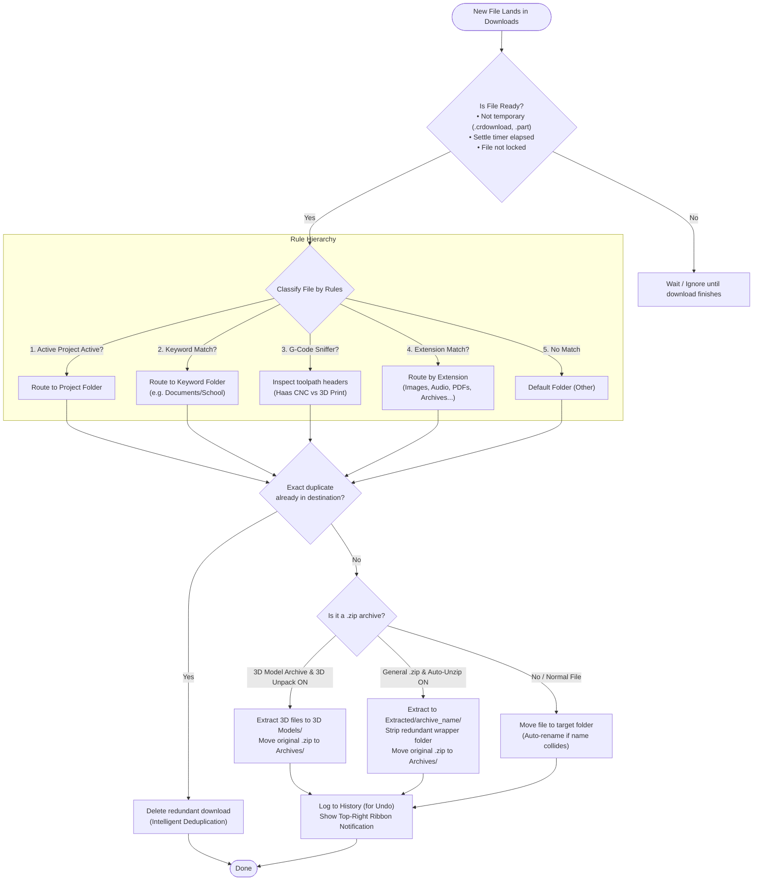

# Download Sorter Architecture & Processing Flowchart

This document details the decision lifecycle of files processed by the Download Sorter background daemon and manual execution scripts.

## Processing Flowchart

## Step-by-Step Breakdown

1. **Pre-Flight Checks (`is_file_ready_to_move`)**:
   - **Incomplete Browser Downloads**: Files ending with `.crdownload`, `.part`, `.partial`, `.tmp`, `.download`, or `.opdownload` are ignored until the browser finalizes the download.
   - **Settle Timer (`settle_seconds`)**: Verifies that the file's modification timestamp hasn't changed within the settle window (default 1.5s).
   - **Lock Detection**: Uses Windows `CreateFileW` with exclusive share flags to ensure the writing application (browser/slicer/CAD) has completely closed its file handle.
   - **Cloud Placeholder Defense**: Detects unhydrated OneDrive cloud placeholders (`FILE_ATTRIBUTE_RECALL_ON_OPEN` / `FILE_ATTRIBUTE_OFFLINE`) to prevent moving files still owned by the cloud provider.

2. **Classification Hierarchy (`evaluate_routing`)**:
   - **Active Project Mode**: If a project timer is active (set via HUD or tray), any CAD, 3D model, or toolpath file is routed straight to the project directory.
   - **Keyword Rules**: Filename tokens are matched first (e.g. `syllabus`, `homework`, `me3210` $\rightarrow$ `Documents\School`).
   - **G-Code Machine Sniffer (`gcode_peek.py`)**: Analyzes internal G-code headers and comments to route Haas CNC files to `Code\Haas` and 3D printer g-code to `Code\Gcode`.
   - **Extension Rules**: Standard mapping for general formats (`.stl`, `.step`, `.pdf`, `.docx`, `.png`, `.mp4`, `.zip`, `.exe`, etc.).
   - **Fallback**: Uncategorized files fall into `Other`.

3. **Intelligent Deduplication**:
   - Compares the file size and SHA-256 chunk hash against files with matching names in the destination folder.
   - If an exact duplicate exists, the newly downloaded copy is pruned to avoid `filename (1).ext` clutter.

4. **Archive Handling & Auto-Unzipping**:
   - **3D Archives (`unzip_3d.py`)**: MakerWorld / Printables archives containing 3D models are unpacked into `3D Models\<archive_name>\` or flattened if single-model. The archive moves to `Archives\`.
   - **General Archives (`unzip_archive.py`)**: Non-3D `.zip` archives are extracted into `Extracted\<archive_name>\`. Redundant root folders are smartly stripped, and the original archive moves to `Archives\`.
   - **Zip Slip Defense**: Path traversal characters (`../`) are rejected to secure the host filesystem.

5. **History & User Feedback**:
   - Every file move or extraction is appended to `%LOCALAPPDATA%\download-sorter\history.jsonl` with batch IDs.
   - Runs can be undone at any time using `sort_undo.py`.
   - An interactive non-blocking ribbon popup (`ribbon_popup.py`) surfaces in the top-right corner of the primary display with one-click click-to-reveal in Windows File Explorer.
