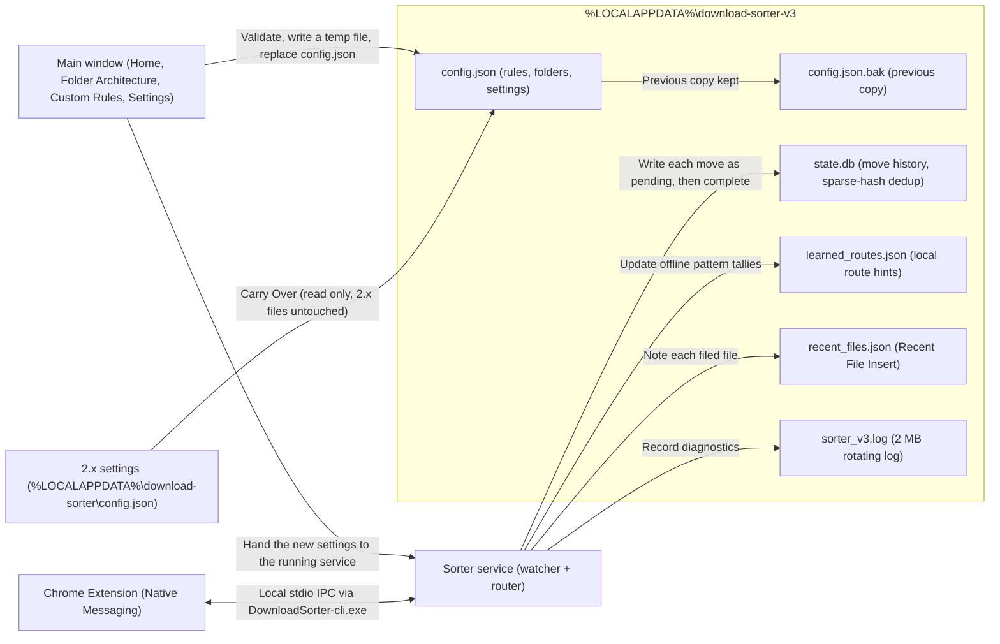

# Download Sorter Architecture & Processing Flowchart

_Made by Devyn Fidel (2026)_

How the configuration is loaded and reloaded. For how a file is sorted, see the README.

---

## 1. How a file is sorted

The four-step routing order of how Download Sorter decides where a file goes, and what it does before moving anything, is in the README: [How a file's folder is chosen](README.md#how-a-files-folder-is-chosen). It is kept in one place so it stays accurate.

---

## 2. Where settings and history live

### Key safety guarantees
1. **Atomic saves**: settings are validated, written to a temporary file and swapped into place with `os.replace`. If `config.json` is damaged, the `.bak` copy is used.
2. **New settings apply without a restart**: the window passes them to the running service, which swaps them in; the tray and watcher keep running.
3. **Crash-safe history**: each move is recorded as pending before the file is touched and marked complete afterwards. On the next start, anything left pending is checked against what is on disk.
4. **Reversible**: every batch can be undone from Home, from the ribbon, or with `--undo`. Undo never overwrites a newer file (it saves the old one as `name (Restored).ext`).
5. **2.x settings are never changed**: Carry Over only reads them.
