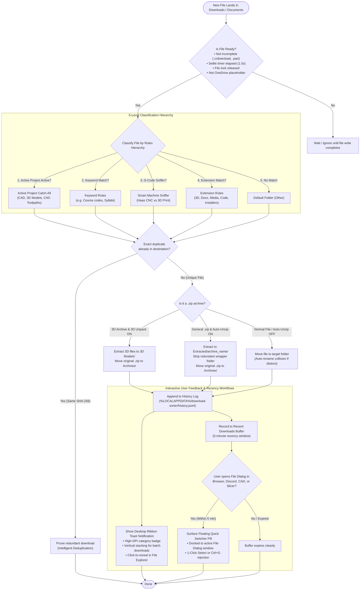
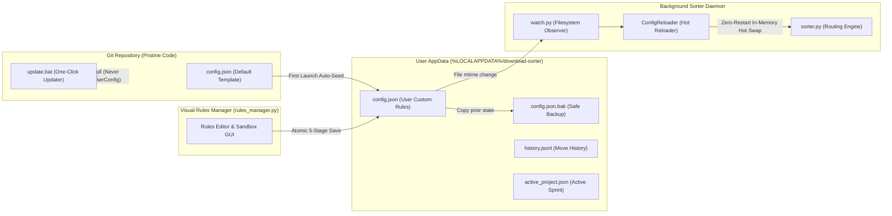

# Download Sorter Architecture & Processing Flowchart

This document details the complete end-to-end decision lifecycle of files processed by the Download Sorter background daemon, interactive desktop modules, and configuration management engine.

---

## 1. Core File Processing & Lifecycle Flowchart

---

## 2. Step-by-Step Architecture Breakdown

### Step 1: Pre-Flight Safety Checks (`is_file_ready_to_move`)
Before attempting to inspect or move any file, the daemon performs non-destructive safety checks:
* **Incomplete Download Filter**: Files ending with browser staging extensions (`.crdownload`, `.part`, `.partial`, `.tmp`, `.download`, `.opdownload`) are bypassed until the downloading browser finishes.
* **Settle Window (`settle_seconds`)**: Verifies that the file size and modification timestamp remain unchanged across a 1.5-second settle threshold.
* **Exclusive Win32 Lock Test**: Calls Windows `CreateFileW` with exclusive share permissions. If another process (e.g. Chrome, Firefox, Bambu Studio, Fusion 360) is still writing to or packaging the file, the move is queued and deferred.
* **OneDrive Cloud Placeholder Defense**: Inspects Win32 filesystem attributes for `FILE_ATTRIBUTE_RECALL_ON_OPEN` and `FILE_ATTRIBUTE_OFFLINE`. Unhydrated cloud files are safely ignored to avoid unwanted cloud re-downloads or sync thrashing.

---

### Step 2: 5-Level Classification Hierarchy (`evaluate_routing`)
Files are classified strictly in order of precedence:
1. **Active Project Catch-All Mode**: When an engineering sprint, lab assignment, or build is active (configured with an auto-expiry timer in the GUI), any incoming CAD, 3D model, or CNC program automatically routes straight into that project's folder.
2. **Keyword Token Rules**: Filenames are tokenized and checked against custom keyword rules (e.g., `syllabus`, `homework`, `me3210` $\rightarrow$ `Documents\School`).
3. **Smart G-Code Machine Sniffer (`gcode_peek.py`)**: Ambiguous toolpaths (`.nc`, `.tap`, `.gcode`, `.bgcode`) are sniffed in the first kilobyte of content:
   * **Haas CNC Mill/Lathe Programs**: Identified by coordinate systems (`G90 G54`), `%` program blocks, and Haas postamble codes $\rightarrow$ routed to `Code\Haas`.
   * **3D Printer Slices**: Identified by Bambu Studio, PrusaSlicer, Cura, or Klipper metadata $\rightarrow$ routed to `Code\Gcode`.
4. **Extension Rules**: Standard mapping for general formats (`.stl`, `.3mf`, `.pdf`, `.docx`, `.xlsx`, `.png`, `.mp4`, `.zip`, `.exe`, etc.).
5. **Default Fallback**: Unmatched files route to `Other/`.

---

### Step 3: Intelligent Deduplication & Collision Handling
* **Exact Duplicate Pruning**: If a file with the same name already exists in the target destination, Download Sorter computes a chunked SHA-256 hash. If byte-for-byte identical, the redundant newly downloaded file is pruned to eliminate `file (1).ext` clutter.
* **Collision Auto-Renaming**: If names collide but hashes differ, the file is safely auto-incremented (`filename (1).ext`) to prevent overwriting unique work.

---

### Step 4: Archive Handling & Auto-Unzipping
* **3D Model Archives (`unzip_3d.py`)**: Archives containing 3D models (from MakerWorld, Printables, Thingiverse) are extracted directly into `3D Models\<archive_name>\` (or flattened if a single model), preserving textures and 3MF metadata while moving the original ZIP to `Archives\`.
* **General Archives (`unzip_archive.py`)**: Extracted to `Extracted\<archive_name>\` with automatic redundant single-wrapper directory stripping (`archive/archive/...` $\rightarrow$ `archive/...`).
* **Zip Slip Path Traversal Protection**: Every zip entry is strictly validated to ensure extract targets cannot escape the target destination directory.

---

### Step 5: Interactive Desktop Notifications (`ribbon_popup.py`)
Upon successful sorting, a modern toast ribbon surfaces:
* **Per-Monitor High-DPI Rendering**: Crystal clear rendering on 100%, 125%, 150%, 175%, and 200% Windows scaling.
* **Dynamic Category Badges & Accents**: Distinct color coding (Mint for 3D/CAD, Red for CNC/Code, Blue for Documents).
* **Dynamic Vertical Stacking**: Multi-file batch downloads automatically stack down the right margin without overlapping.
* **1-Click Reveal**: Clicking the ribbon toast instantly reveals and highlights the sorted file in Windows File Explorer.
* **Hover Freeze**: Hovering pauses the progress countdown timer.

---

### Step 6: Recency-Gated Quick Switcher (`quick_switcher.py`)
When you download a file and immediately want to upload or open it in another app:
* **Recency Buffer**: Sorted files are tracked in a 5-minute recency queue.
* **Win32 Dialog Discovery**: A background monitor detects standard Windows File Open / Upload dialogs (`#32770`) launched by Discord, Slack, Chrome, Edge, Fusion 360, or CAD software.
* **Floating Switcher Pill**: An unobtrusive pill docks directly to the active file dialog.
* **Zero-Friction Selection**: Clicking **Select** (or pressing `Ctrl+G`) automatically injects the path and chooses the recently downloaded file without requiring manual folder browsing. If ignored, it auto-dismisses cleanly.

---

## 3. Configuration & Zero-Restart Hot-Reload Flowchart

### Key Safety Guarantees:
1. **Isolated User Config**: User custom rules live in `%LOCALAPPDATA%\download-sorter\config.json`. Pulling or updating repository code never conflicts with or overwrites user rules.
2. **5-Stage Atomic Persistence**: Rule updates are validated, written to a unique temporary file, flushed with `os.fsync`, backed up to `.bak`, and atomically replaced with Windows lock retries.
3. **Zero-Restart Live Reloading**: Modifying rules in `rules_manager.py` instantly propagates to the running daemon without restarting the tray app or losing state.
4. **Reversible History**: Every batch is recorded with UUIDs in `history.jsonl` and can be fully undone with `sort_undo.py`.
