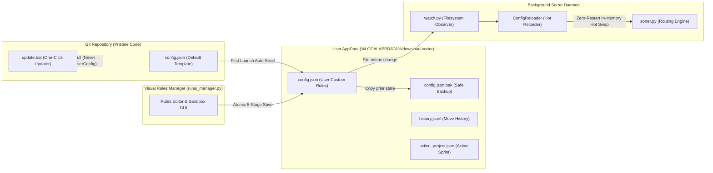

# Download Sorter Architecture & Processing Flowchart

_Made by Devyn Fidel (2026)_

How the configuration is loaded and reloaded. For how a file is sorted, see the README.

---

## 1. How a file is sorted

The flowchart of how Download Sorter decides where a file goes, and what it does with it, is in the README: [How Download Sorter decides where a file goes](README.md#how-download-sorter-decides-where-a-file-goes). It is kept in one place so it stays correct.

---

## 2. Configuration & Zero-Restart Hot-Reload Flowchart

### Key Safety Guarantees:
1. **Isolated User Config**: User custom rules live in `%LOCALAPPDATA%\download-sorter\config.json`. Pulling or updating repository code never conflicts with or overwrites user rules.
2. **5-Stage Atomic Persistence**: Rule updates are validated, written to a unique temporary file, flushed with `os.fsync`, backed up to `.bak`, and atomically replaced with Windows lock retries.
3. **Zero-Restart Live Reloading**: Modifying rules in `rules_manager.py` instantly propagates to the running daemon without restarting the tray app or losing state.
4. **Reversible History**: Every batch is recorded with UUIDs in `history.jsonl` and can be fully undone with `sort_undo.py`.
