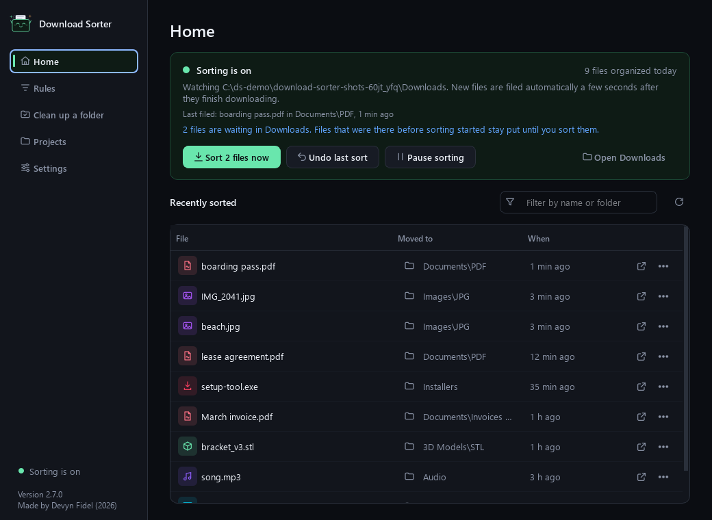
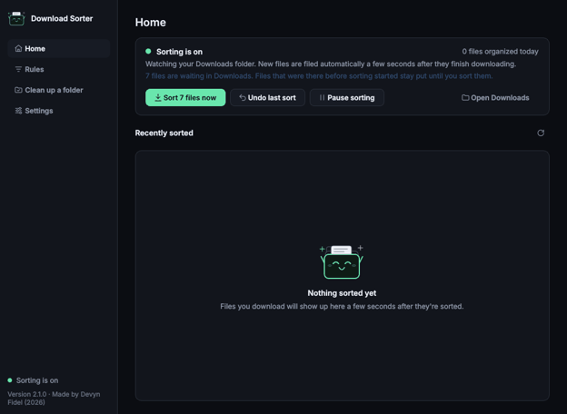
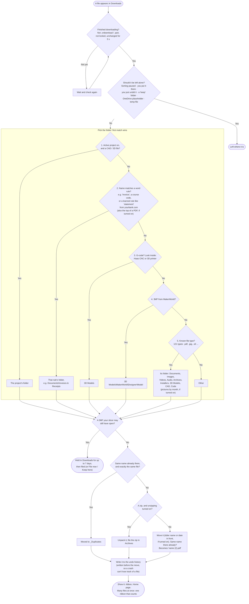

# Download Sorter

> **Made by Devyn Fidel (2026)** · v2.3.0 · [MIT License](LICENSE)

[](https://github.com/The-Osprey1/Download-Sorter/releases)
[](https://github.com/The-Osprey1/Download-Sorter/actions)
[](https://microsoft.com/windows)
[](LICENSE)

**Download Sorter keeps your Downloads folder tidy.** A few seconds after a download finishes, it moves the file into a folder for its type (PDFs, Images, Installers and so on), right inside Downloads. Everything happens on your PC, and every move can be undone.



---

## Get it

1. **Download** the installer, `DownloadSorter-Setup-v2.3.0-windows-x64.exe`, from the [latest release](https://github.com/The-Osprey1/Download-Sorter/releases/latest).
2. **Run it.** Windows will probably show a blue "Windows protected your PC" screen the first time. [Here's why, and what to click](#windows-protected-your-pc).
   - It installs just for you, in `%LOCALAPPDATA%\Programs\DownloadSorter`. No administrator password is needed.
   - It adds Start menu and desktop shortcuts, and an entry in Installed apps.
3. **Answer the welcome steps.**
   - Pick the profile that fits you best: Everyday, Student, Office and work, or 3D printing, CAD and CNC.
   - Then choose whether to:
     - start Download Sorter when you sign in
     - add a right-click menu item
     - sort the files already in Downloads
     - unzip downloaded zip files

You need Windows 10 or 11. Nothing else needs to be installed.

## What happens next

- **Setup starts from your own folders.** The first welcome step shows the folders already in your Downloads folder (like `Invoices` or `IME 4030`) and offers to keep filing matching files into them. If there are none yet, you tick the kinds of files you want sorted.
- **Nothing moves until you finish the welcome steps.** If you chose to sort the files already in Downloads, that first sort counts as one batch, so a single **Undo last sort** puts everything back.
- **New downloads are filed a few seconds after they finish.** Half-finished downloads are left alone.
- **The Home page shows each file as it's filed**, with where it went and an Undo button:

  

- **Files land in folders inside Downloads**, for example:

  ```text
  Downloads/
    ├── Documents/   (PDF, Word, text, spreadsheets, presentations, e-books,
    │                 plus folders from your profile, like Invoices & Receipts)
    ├── Images/
    ├── Videos/
    ├── Audio/
    ├── Archives/    (zip, 7z, rar ...)
    ├── Installers/  (exe, msi, msix)
    ├── 3D Models/   (STL, 3MF, STEP, CAD, G-code ...)
    ├── Code/
    └── Other/       (anything no rule matched)
  ```

  You can change where things go on the **Rules** page, and test a file name with **Try a filename** before saving.
- **Files you move yourself stay where you put them.** If you drag a sorted file into your own folder inside Downloads, Download Sorter leaves it there.
- **Extra options in Settings**, all off until you turn them on: pictures in a folder per month, rule words found at the top of PDFs, tidier names or the date in front (Undo restores the old name), and old installers and zips to the Recycle Bin once a day. Settings also warns you if Windows Storage Sense is set to delete old files in Downloads, which would include your sorted files.
- **It learns from your moves, and asks first.** After you've moved 3 similar files into one folder, a ribbon asks “Put files like this in Banking?”. **Yes** adds a rule you can see and change on the Rules page; **No** means it won't ask again. It never moves a file on a guess. You can turn learning off in Settings.

## How Download Sorter decides where a file goes

Every file goes through the same steps. The first step that gives an answer wins, and nothing is ever deleted: a file that's an exact copy goes to `_Duplicates`, and every move can be undone.



**In words:**

1. **Wait until the download is finished.** Browsers write to `.crdownload` or `.part` files first, and big files take a while. Download Sorter waits until the file has stopped changing for 3 seconds and no other program has it open.
2. **Skip what it shouldn't touch:** files you moved yourself, files you just undid, folders with a `.download-sorter-keep` file, OneDrive files that aren't on your PC yet, and temporary files like `~$report.docx`.
3. **Pick the folder.** The rules are checked in order and the first match wins:
   - an **active project**, for CAD and 3D files, when you've turned one on;
   - **word rules**, which look for whole words in the file name, so "statement" alone doesn't send your personal statement to Invoices. They come from your folders at setup, from ready-made starter rules, or from rules you said **Yes** to when it learned from your moves. A rule can also require the website a file came from;
   - the **G-code check**, which looks inside `.nc`/`.gcode` files to tell a Haas CNC program from a 3D printer file;
   - **MakerWorld 3MF files**, filed by designer and model name;
   - the **file type**: 121 extensions mapped to the main folders;
   - otherwise **Other**.
4. **3MF hold.** A 3MF file you just downloaded may be open in your slicer, so it stays in Downloads for up to 7 days. The ribbon offers **File now** and **Keep here**.
5. **Duplicates.** If a file with the same name is already in the destination folder and the two are identical (checked byte by byte), the new copy goes to `_Duplicates` instead of becoming `report (2).pdf`.
6. **Zips** are only unpacked if you turned that on in the welcome steps or in Settings.
7. **Move and record.** If you turned on tidy names or dates, the file gets its new name here. Each move is written to the undo history *before* it happens and marked done after. If the PC crashes halfway, the next start finishes or reverses it. **Undo** puts files back exactly where they were.
8. **Tell you.** A ribbon slides in for each file. When lots of files arrive together, the first 3 get their own ribbon, then one ribbon counts the rest ("Filed 37 files · Images 25 · Documents 12") with **Open** and **Undo**.

The code for each step: readiness and skipping in `sorter.move_file` and `sorter.is_file_ready_to_move`, the folder choice in `sorter.evaluate_routing` (try it on the **Rules** page with **Try a filename**), the hold in `hold_manager.py`, the history in `safe_ops.py`, and the ribbons in `ribbon_popup.py`.

## Windows protected your PC

New apps from small developers aren't signed with a paid code-signing certificate yet, so Windows SmartScreen warns about them. To install anyway:

1. Click **More info**.
2. Click **Run anyway**.

To check that your download is exactly what was published:

1. Download `checksums.txt` from the same release page.
2. Run this in PowerShell, in the folder where the installer is:

   ```powershell
   Get-FileHash .\DownloadSorter-Setup-v2.3.0-windows-x64.exe -Algorithm SHA256
   ```

3. The long code it prints should match the line for the installer in `checksums.txt`.

All the source code is in this repository, and the installer is built from it by GitHub, in the open (see the [release workflow](.github/workflows/release.yml)).

## Privacy

- **Your files never leave your PC.** Sorting, rules, history and logs all stay in `%LOCALAPPDATA%\download-sorter`.
- **One small network request, once a day:** Download Sorter asks GitHub which version is newest, so it can tell you when there's an update. Only the app's name and version are sent. An update is only downloaded when you click **Download and install**, and only from this project's GitHub release page. Turn it off in **Settings**, under "Check for new versions once a day".
- **Learning is off by default.** If you turn it on, it learns from your own moves, entirely on your PC. **Forget everything** in Settings deletes it.
- No accounts, no ads, no tracking.

## Undo, updates, uninstalling and help

- **Undo:** click **Undo last sort** on Home, or right-click the tray icon (near the clock) and choose **Undo last sort**.
- **Pause:** use **Pause sorting** on Home, or the tray icon.
- **Updates:** when a new version is out, Home shows "Download Sorter X is available". Click **Download and install**: it downloads in the app (with progress), checks the file against the release's published checksum, then **Restart and install** closes Download Sorter for a few seconds and opens it again. Your rules and settings are kept. (Versions before 2.2 open the download page instead; download and run the installer once.)
- **Uninstall:** go to Windows Settings, then Apps, then Installed apps, then Download Sorter, then Uninstall. It asks whether to also delete your rules and history.
- **Something went wrong?** [Report a bug](https://github.com/The-Osprey1/Download-Sorter/issues/new?template=bug_report.yml). The log helps a lot: right-click the tray icon, choose **Open log folder**, and attach `sorter.log`.

*Unattended install, for IT folks:* `DownloadSorter-Setup-v2.3.0-windows-x64.exe /S` (optional `/D=C:\Custom\Path`). The Inno Setup spellings `/VERYSILENT`, `/SILENT` and `/DIR=` work too.

---

# For power users and developers

Everything below describes the features in more depth, the command-line tools, and how to build Download Sorter from source.

With the **3D Printing, CAD & CNC** profile, stray CAD and 3D files (e.g. `.stl`, `.step`, `.3mf`) found in Windows Documents are also organized into the Downloads 3D tree. Other profiles never touch your Documents folder. Application folders (like `OneDrive`, `Steam`, `My Games`, `SOLIDCast`, `Adobe`) and OneDrive cloud placeholders are always protected and skipped.

## Features in detail

### 1. The Download Sorter window (`rules_manager.py`, `onboarding.py`)
A dark-mode window built with **PySide6**. A sidebar switches between four pages:
* **Home**: whether sorting is on, **Sort Downloads now**, **Undo last sort**, pause and resume, and the files sorted most recently.
* **Rules**: **Name rules** (words in a file's name, checked top to bottom) and **File types** (by extension). Add ready-made rules from the **rule library**, import or export them, and use **Try a filename** to see where a file would go before you save. With the 3D printing profile, **Project mode** sends all CAD, 3D and CNC downloads to one project folder for a while.
* **Clean up a folder**: preview how a messy folder would be organized, choose **Organize by file type**, **Keep intact** or **Skip for now** for each folder inside it, then apply. Everything can be undone.
* **Settings**: your profile, starting with Windows, the right-click menu, zip handling, and version information.
* **Learning (preview, off by default)**: switch it on in Settings and Download Sorter learns from the files you move into your own folders inside Downloads: the words in their names, their type and the website they came from. For now it only keeps a practice log of the folder it would have suggested, so you can check how often it would have been right ("See what it has learned"). Nothing is sent anywhere, and "Forget everything" deletes it.

Changes to rules are saved with schema checks, a `config.json.bak` backup and an atomic file replace.

```powershell
# Open the window
download-sorter-gui
# Or open a page directly: home, rules, remodel (Clean up a folder) or settings
download-sorter-gui --tab remodel
```

### 2. 3-Path Batch File Handoff Quick Switcher (`quick_switcher.py`)
Downloading multi-part models, document batches, or asset sets? The Quick Switcher coalesces downloads arriving within a 25-second window:
* **Floating Switcher Pill**: Docks an unobtrusive floating pill directly beside any active Windows File Open / Upload dialog.
* **3 Handoff Paths**:
  * **`↵ Latest`** (`Ctrl+G`): Instantly injects the most recent file into the dialog.
  * **`⇉ All N`** (`Ctrl+Shift+G`): Injects the entire batch simultaneously using hidden `.batch_stage` NTFS hardlinks (no disk duplication).
  * **`⧉ Copy`** (`Ctrl+Shift+C`): Copies all batch files to the Windows clipboard as a native `CF_HDROP` file list for immediate pasting with `Ctrl+V`.
* **Native OLE Drag & Drop**: Drag the pill or individual files directly into CAD, slicers, or Explorer folders.
* **Interactive Hover Checklist**: Hover over the pill to untick unwanted files before committing the handoff.

### 3. 3MF Grace-Period Hold & MakerWorld Intelligence (`hold_manager.py`)
Moving `.3mf` files immediately often breaks Bambu Studio's in-app shortcuts, recent projects, and `Ctrl+S` incremental saves. Version 2 solves this:
* **7-Day Idle Hold**: Incoming `.3mf` files remain in `Downloads\` for up to 7 days without relocation.
* **Slicer Process Awareness**: Checks if Bambu Studio, OrcaSlicer, or PrusaSlicer are running or holding file locks; holds are extended up to 14 days while actively in use.
* **Desktop Ribbon Thumbnail Preview**: Parses and displays the embedded plate preview thumbnail inside the ribbon banner, with **`File now`** and **`Keep here`** buttons.
* **Empirical MakerWorld Detection**: Secure `defusedxml` parser distinguishes MakerWorld downloads from local saves, routing models to `3D Models\MakerWorld\<Author>\<Model>\<Plate>.3mf`.
* **System Tray Indicator**: Real-time tray badge showing currently held 3MF counts and remaining hold duration.

### 4. Staged Machine Remodel Engine (`remodel.py`)
Safely remodel old or messy PCs with chaotic file structures:
* **Deep Engineering & Simulation Protections**: Automatically identifies and leaves intact:
  * **SOLIDCast**: `.fsimodel9`, `.fsimodel*`, `.afs`, `.gdproj`, `.fsimaterials`, `FLOWCast.set`, `$mesh*.out`, `.abin`, `inuse.lok`.
  * **MAGMASOFT**: `.magma`, `.magmainteract`, simulation output directories.
  * **CAD Assemblies**: SolidWorks, Inventor, Fusion 360, STEP, IGES files.
  * **Electronics**: KiCad (`.kicad_*`), Arduino (`.ino`, `.pde`).
  * **Dev Repositories**: `.git`, `.venv`, `node_modules`, `build`, `dist`.
  * **Active Folders**: Folders modified within 14 days.
  * **Explicit Keep Marker**: Any folder containing `.download-sorter-keep`.
* **3-Stage Deduplication**: File size grouping -> 64KB fast hash -> full SHA-256 + NTFS inode verification.
* **30-Day Quarantine**: Moves duplicates to `<root>\_Remodel Quarantine\remodel_<id>\Duplicates\`.
* **HTML Receipt & 1-Click Undo**: Generates a self-contained, searchable `Where did my files go.html` in the remodeled root, and supports instant reversal via `download-sorter-remodel --undo`.

```powershell
# Scan a folder and preview candidate cards
download-sorter-remodel --scan "C:\Users\<user>\Downloads"

# Dry run simulation
download-sorter-remodel --dry-run "C:\Users\<user>\Downloads"

# Apply remodel safely
download-sorter-remodel --apply "C:\Users\<user>\Downloads"

# Revert a remodel completely
download-sorter-remodel --undo
```

### 5. Low-Resource Background Daemon & System Tray (`tray.py`)
* **Background Watchdog**: Watches Downloads (and Documents, with the Maker profile) using low-CPU native event hooks.
* **Single-Instance Mutex**: Prevents multiple daemon instances from colliding.
* **Instant Tray Control**: Right-click the tray icon to pause/resume sorting, trigger manual sorts, undo recent moves, remodel messy folders, or open rules.
* **Live Daily Counter**: Displays files sorted today and active held 3MF models.

```powershell
# Run the tray monitor (background watcher lives inside)
download-sorter-tray
```

### 6. Desktop Ribbon Toast Notifications (`ribbon_popup.py`)
* **One-Click Reveal**: Click the notification pill to highlight sorted files in Windows File Explorer.
* **3MF Plate Previews**: Embedded thumbnails with quick **File now** and **Keep here** actions.
* **Vertical Dynamic Stacking**: Stacks simultaneous downloads neatly down the right margin.
* **Big batches without the spam**: when lots of files land at once, the first 3 get their own ribbon, then one ribbon counts the rest while they arrive ("Filed 37 files · Images 25 · Documents 12") with **Open** and **Undo** for the whole batch.
* **Per-Monitor High-DPI Awareness**: Crystal-clear typography on all display scaling levels.

### 7. 3D Print Inspector & CNC Machine Sniffer (`gcode_peek.py`)
* **Haas vs 3D Detection**: Inspects initial lines of ambiguous toolpaths (`.nc`, `.tap`, `.gcode`, `.bgcode`) to differentiate Haas CNC machine programs from 3D slicer outputs.
* **Embedded Thumbnail Extraction**: Pulls embedded preview thumbnails from `.3mf` and `.gcode` slices.

```powershell
# Inspect latest 3D file in Downloads
gcode-peek --latest

# View embedded thumbnail render
gcode-peek "path\to\model.3mf" --thumb
```

### 8. Smart Archive Unpackers (`unzip_3d.py` & `unzip_archive.py`)
* **3D Zip Flattener**: Unpack MakerWorld, Printables, and Thingiverse archives without nested wrapper folders.
* **Zip Slip Defense**: Strictly validates extraction paths to prevent directory traversal (`../`) attacks.

```powershell
# Unpack all 3D model zips sitting in Downloads
unzip-3d --all

# Extract general archive to Extracted\
unzip-archive "path\to\archive.zip"
```

### 9. Write-Ahead Journal & Crash Recovery (`safe_ops.py`)
* **Atomic 2-Phase Moves**: All file moves log write-ahead `planned` and `done` journal records with disk `fsync`.
* **Automatic Recovery**: On startup, orphaned `planned` records reconcile against real disk state.
* **Non-Overwriting Moves**: Existing targets automatically resolve to `name (2).ext` collisions.

---

## Installation & Setup

### Option 1: Standalone Windows App (No Python Required)
1. Download the latest **`DownloadSorter-v<version>-windows-x64.zip`** from [GitHub Releases](https://github.com/The-Osprey1/Download-Sorter/releases).
2. Extract the ZIP anywhere on your system (e.g. `C:\Users\<user>\Download-Sorter` or Program Files).
3. Double-click **`setup.bat`** (or run `.\setup.bat`). It will:
   - Configure optional automatic startup at login.
   - Configure right-click Explorer context menus.
   - Offer an optional scan of your Downloads folder to preview remodeling.
   - Launch the background system tray monitor immediately.

---

### Option 2: Python Source Installation (For Developers)

#### Quick Start (One-Click)
Double-click **`setup.bat`** (or run `.\setup.bat` in PowerShell/CMD). It will automatically:
1. Detect Python 3.10+ (supporting `python`, official `py -3` launcher, `python3`, or offer `winget` installation)
2. Create your `.venv` virtual environment
3. Install dependencies from `requirements.txt`
4. Configure optional auto-start at login and Explorer context menus
5. Launch the system tray icon

---

### Updating to the Latest Version (One-Click)
Double-click **`update.bat`** (or run `.\update.bat` in PowerShell/CMD). It will:
1. Safely stop running background daemon and tray instances
2. Pull the latest commits from GitHub (`git pull`)
3. Synchronize any updated dependencies inside `.venv`
4. Restart the system tray application automatically

*(Because custom rules are stored safely in `%LOCALAPPDATA%\download-sorter\config.json`, updating will never conflict with or erase your personalized sorting rules).*

---

### Manual Setup (CLI / Pip)
```powershell
git clone https://github.com/The-Osprey1/Download-Sorter.git
cd Download-Sorter

# Create virtual environment
python -m venv .venv

# Install editable package with dependencies
.\.venv\Scripts\pip.exe install -e .
```

### Windows Explorer Right-Click Shortcuts (Optional)
Add convenient right-click options in File Explorer (installed for the current user, no Administrator privileges required):

```powershell
powershell -ExecutionPolicy Bypass -File .\install_context_menu.ps1
```

* **Folder right-click**: `"Sort with DownloadSorter"`
* **Folder background right-click**: `"Undo Last DownloadSorter Batch"`
* **`.3mf` / `.gcode` right-click**: `"Inspect 3D Print Info (gcode-peek)"`
* **`.zip` right-click**: `"Extract 3D Models to Downloads"`

To remove the context menu entries:
```powershell
powershell -ExecutionPolicy Bypass -File .\uninstall_context_menu.ps1
```

### Auto-Start at Login (Optional)
To register Download Sorter as a persistent Windows Scheduled Task that starts at user logon:

```powershell
powershell -ExecutionPolicy Bypass -File .\install_startup.ps1
```

To remove the scheduled task:
```powershell
powershell -ExecutionPolicy Bypass -File .\uninstall_startup.ps1
```

---

## Command Line Usage

Download Sorter installs dedicated CLI console scripts on PATH:

| Command | Action |
|:---|:---|
| `download-sorter` | Run one-pass sorting batch on Downloads |
| `download-sorter --dry-run` | Simulate sorting without moving files |
| `download-sorter --target <dir>` | Sort a specific directory once |
| `download-sorter-watch` | Run foreground directory watcher daemon |
| `download-sorter-tray` | Launch system tray monitor with background daemon |
| `download-sorter-gui` | Open the Download Sorter window |
| `download-sorter-gui --tab remodel` | Open the window on the "Clean up a folder" page |
| `download-sorter-remodel --scan` | Scan folder and preview candidate remodel cards |
| `download-sorter-remodel --dry-run` | Simulate machine remodel actions and output summary |
| `download-sorter-remodel --apply` | Execute safe machine remodel with HTML receipt |
| `download-sorter-remodel --undo` | Reversibly undo previous machine remodel |
| `download-sorter-undo` | Reversibly undo previous download sorting batch |
| `gcode-peek <file>` | Inspect 3D print file / CNC toolpath |
| `gcode-peek --latest` | Inspect most recent 3D file in Downloads |
| `unzip-3d <zip>` | Flatten and unpack 3D models from archive |
| `unzip-archive <zip>` | Safely unpack archive into `Extracted/` |
| `python status.py` | Print daemon health, memory, held files, and recent moves |
| `python clean_old.py` | Recycle old installers/archives (>30 days) to Recycle Bin |
| `<any-command> --version` | Print Download Sorter version and attribution credit |
| `<any-command> --help` | Display command usage and option details |

---

## Testing & Quality Assurance

This repository includes a comprehensive 4-Tier test suite covering feature tests, boundary cases, cross-feature interactions, visual design consistency, and real-world stress scenarios:

```powershell
# Install the test tools (not needed to use the app)
.\.venv\Scripts\pip.exe install -e .[dev]

# Run the complete test suite
.\.venv\Scripts\pytest.exe

# Run visual design consistency tests only
.\.venv\Scripts\pytest.exe tests/test_visual_consistency.py -v

# Run v2 E2E acceptance tests only
.\.venv\Scripts\pytest.exe tests/test_e2e_v2_features.py -v
```

---

## Safety & Privacy

* **Local-first**: no analytics or telemetry, and all sorting happens on your PC. The only network request is the optional once-a-day version check described in [Privacy](#privacy).
* **Non-Destructive Cleanup**: Clean scripts send items strictly to the Windows Recycle Bin using native Windows Shell API (`SHFileOperationW` with `FOF_ALLOWUNDO`).
* **Path Traversal Protection**: Archive extractors and 3MF parsers reject any archive member with directory traversal markers (`../` or leading root slashes).
* **Write-Ahead Journaling**: Safe 2-phase move operations with crash recovery prevent data loss during power outages or unexpected interruptions.
* **Atomic Configuration**: Config persistence creates `.bak` backups before swapping files to guarantee zero configuration loss if interrupted.

---

## Frequently Asked Questions (FAQ)

### Windows SmartScreen displays a warning when running `DownloadSorter.exe`. Is it safe?
Yes. SmartScreen flags newly released binaries from GitHub that have not yet built up download reputation or are not signed with a paid Extended Validation (EV) code signing certificate. To proceed:
1. Click **More info**.
2. Click **Run anyway**.
The application is open source, and the installer is built from this repository by GitHub. See [Windows protected your PC](#windows-protected-your-pc) for how to check your download.

### Where are my custom rules saved?
Your personal rule configurations, custom keywords, and category folders are stored in:
`%LOCALAPPDATA%\download-sorter\config.json`
This keeps your settings strictly isolated from the application directory. Updating the application or pulling new commits will never overwrite your personal rules.

### How do I undo a sort batch?
If a batch was sorted into the wrong place, you can immediately revert it:
* **Via System Tray**: Right-click the Download Sorter icon and click **"Undo last sort"**.
* **Via File Explorer**: Right-click the background of any folder and click **"Undo Last DownloadSorter Batch"**.
* **Via Command Line**: Run `download-sorter-undo` (or `python sort_undo.py`).

### Does Download Sorter support OneDrive or moved Downloads folders?
Yes! Download Sorter automatically checks Windows Shell Known Folders (`FOLDERID_Downloads` registry key) to detect your active Downloads folder even if you redirected it to another drive (e.g. `D:\Downloads`). For OneDrive, cloud-only placeholder files (smart sync) are automatically detected via Windows file attributes and skipped until fully downloaded locally.

---

## Contributing & Security

* **Contributing**: Check out [CONTRIBUTING.md](CONTRIBUTING.md) for local development instructions, test guidelines, and how to submit new rule presets.
* **Security & Privacy**: Read our [SECURITY.md](SECURITY.md) policy: no telemetry, local-first, and how to report a problem.
* **Changelog**: See [CHANGELOG.md](CHANGELOG.md) for version release history.

---

## Credits

**Download Sorter** was created by **Devyn Fidel** (2026).  
Repository: https://github.com/The-Osprey1/Download-Sorter

Every surface that shows credit (tray tooltip and menu, `status`, the window's sidebar and Settings page, every CLI's `--version`, `setup.bat`, `update.bat`, `install_context_menu.ps1`, `install_startup.ps1`) reads it from the single `about.py` module, so the credit line is always identical.

---

## License

This project is licensed under the [MIT License](LICENSE) - Copyright (c) 2026 Devyn Fidel.
