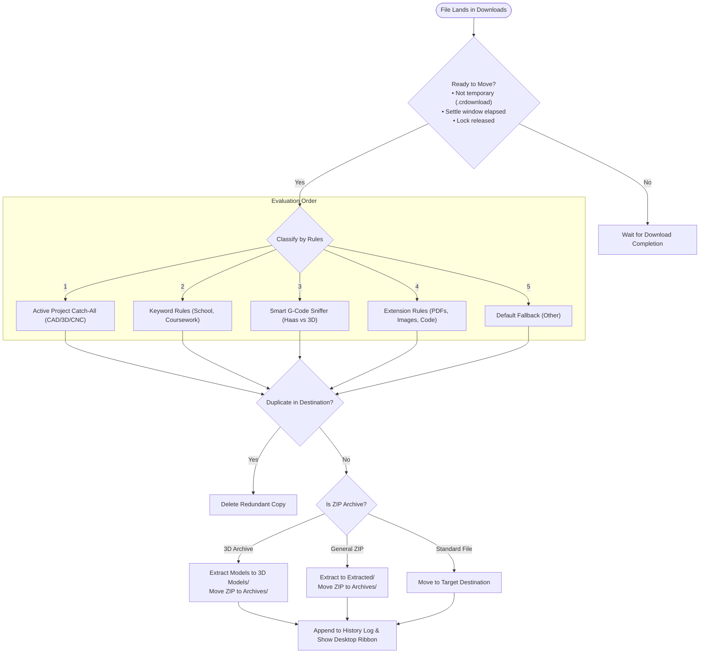

# download-sorter

[](https://www.python.org/)
[](LICENSE)
[](https://microsoft.com/windows)
[](tests/)

A lightweight, local-first automated file organizer for Windows that keeps your **Downloads** and **Documents** folders organized without sending your data to any cloud service.

Includes a **PySide6 Visual Rules Manager & Live Sandbox GUI**, **System Tray monitor**, **interactive High-DPI Desktop Ribbon toasts**, **reversible Undo**, and **3D Printing / CNC intelligence**.

---

## Folder Architecture

Newly downloaded files are routed into an organized tree directly inside your Downloads folder:

```text
Downloads/
  ├── 3D Models/
  │     ├── STL/
  │     ├── 3MF/
  │     ├── OBJ/
  │     ├── STEP/
  │     ├── CAD/ (F3D, SLDPRT, IPT, DWG, DXF)
  │     └── Other/
  ├── Documents/
  │     ├── School/ (Course-specific keywords, syllabi, homework)
  │     ├── PDFs/
  │     ├── Word/
  │     └── Text/
  ├── Spreadsheets/ (XLSX, CSV, ODS)
  ├── Images/ (JPG, PNG, WebP, SVG, HEIC)
  ├── Videos/ (MP4, MKV, MOV, WebM)
  ├── Audio/ (MP3, WAV, FLAC, AAC)
  ├── Archives/ (Original ZIP, 7Z, RAR)
  ├── Extracted/ (Unpacked landing folders)
  ├── Installers/ (EXE, MSI, MSIX)
  ├── Code/ (PY, JS, TS, CPP, JSON, HTML, CSS, Haas/GCode)
  └── Other/ (Uncategorized fallback)
```

Targeted CAD and 3D files (e.g. `.stl`, `.step`, `.3mf`) found in Windows Documents are safely organized into the Downloads 3D tree, while application folders (like `OneDrive`, `Steam`, `My Games`, `SOLIDCast`, `Adobe`) and OneDrive cloud placeholders are automatically protected and skipped.

---

## Key Features

### 1. Visual Rules Manager & Live Simulator GUI (`rules_manager.py`)
A sleek dark-mode desktop GUI built with **PySide6**:
* **Rule Reordering & Precedence**: Drag or use Up/Down buttons to adjust precedence order between keyword rules and extension rules.
* **Instant Keyword & Folder Editing**: Create custom rules, edit target paths, and toggle rules active/inactive with validation.
* **Live Sandbox & Real-time Simulator**: Type any hypothetical filename (e.g. `ME3210_Exam_Review.pdf`, `bracket_op1.nc`, `vase_multicolor.3mf`) to watch the rule engine evaluate the match chain in real time, showing the winning rule, matched trigger, destination path, and classification badge.
* **Temporary "Active Project" Catch-All**: Working on a sprint or engineering build? Flip on Active Project mode to route all incoming CAD, 3D models, and CNC programs directly to your active project directory with optional auto-expiry.
* **Safe Atomic Persistence**: Changes are verified with schema validation, written to a temporary buffer with `fsync`, backed up to `config.json.bak`, and replaced atomically with transient lock retry handling.

```powershell
# Launch the Visual Rules Manager GUI
.\.venv\Scripts\python.exe rules_manager.py
```

### 2. Low-Resource Background Daemon & System Tray (`tray.py`)
Run the unobtrusive system tray application:
* **Background Watchdog**: Watches top-level Downloads and recursive Documents using low-CPU event hooks.
* **Single-Instance Mutex**: Prevents multiple daemon instances from colliding.
* **Instant Tray Control**: Right-click the tray icon to pause/resume sorting, trigger a manual sort, undo recent moves, configure rules, or open folders.
* **Live Daily Counter**: Hover over or view the tray menu to see how many files have been filed today.

```powershell
# Run the tray monitor (background watcher lives inside)
.\.venv\Scripts\pythonw.exe tray.py
```

### 3. Desktop Ribbon Toast Notifications (`ribbon_popup.py`)
Whenever an incoming download lands and organizes:
* **One-Click Reveal**: Click the notification pill to instantly highlight the sorted file in Windows File Explorer.
* **Vertical Dynamic Stacking**: Simultaneous downloads automatically stack neatly down the right margin without overlapping.
* **Per-Monitor High-DPI Awareness**: Crystal-clear typography on 100%, 125%, 150%, 175%, and 200% scaling.
* **Dynamic Category Accents**: Distinct visual color accents for 3D/CAD (Mint), CNC/G-Code (Red), Documents (Blue), and Media.

### 4. 3D Print Inspector & CNC Machine Sniffer (`gcode_peek.py`)
* **Smart Content Sniffing**: Inspects the first lines of ambiguous toolpaths (`.nc`, `.tap`, `.gcode`, `.bgcode`) to differentiate Haas CNC machine coordinates (`G90 G54`, Haas postamble, program delimiters) from 3D printer slicers (Bambu Studio, PrusaSlicer, Klipper layer comments).
* **Embedded Thumbnail Extraction**: Pulls embedded preview thumbnails from `.3mf` and `.gcode` slices directly to disk.

```powershell
# Inspect latest 3D file in Downloads
.\.venv\Scripts\python.exe gcode_peek.py --latest

# View embedded thumbnail render
.\.venv\Scripts\python.exe gcode_peek.py "path\to\model.3mf" --thumb
```

### 5. Smart Archive Unpackers (`unzip_3d.py` & `unzip_archive.py`)
* **3D Zip Flattener**: Unpack MakerWorld, Printables, and Thingiverse archives without annoying nested subfolders.
* **Root-Stripping**: Automatically strips single redundant top-level wrapper directories (e.g. `archive/archive/...`).
* **Zip Slip Defense**: Strictly validates extraction paths to prevent path traversal (`../`) attacks.

```powershell
# Unpack all 3D model zips sitting in Downloads
.\.venv\Scripts\python.exe unzip_3d.py --all

# Extract general archive to Extracted\
.\.venv\Scripts\python.exe unzip_archive.py "path\to\archive.zip"
```

### 6. Full Reversible Undo & Janitor Cleanup
* **Undo Moves (`sort_undo.py`)**: Reverses recent batches back to their original download directories using the append-only move log (`%LOCALAPPDATA%\download-sorter\history.jsonl`).
* **Safe Janitor (`clean_old.py`)**: Safely recycles old installers and archives to your **Windows Recycle Bin** (never permanent deletion).

```powershell
# Preview undo without moving
.\.venv\Scripts\python.exe sort_undo.py --dry-run

# Undo the most recent sort batch
.\.venv\Scripts\python.exe sort_undo.py

# Clean old downloads (older than 30 days -> Recycle Bin)
.\.venv\Scripts\python.exe clean_old.py --dry-run
```

---

## Decision Lifecycle

For a full breakdown of the sorting, deduplication, and extraction logic, see [FLOWCHART.md](FLOWCHART.md).



---

## Installation & Setup

### Prerequisites
* Windows 10 or 11
* Python 3.10+

### Setup Virtual Environment
```powershell
git clone https://github.com/The-Osprey1/Download-Sorter.git
cd Download-Sorter

# Create virtual environment
python -m venv .venv

# Install dependencies
.\.venv\Scripts\pip.exe install -r requirements.txt
```

### Windows Explorer Right-Click Shortcuts (Optional)
Add convenient right-click options in File Explorer (installed for the current user, no Administrator privileges required):

```powershell
powershell -ExecutionPolicy Bypass -File .\install_context_menu.ps1
```

* **Folder right-click**: `"Sort with DownloadSorter"`
* **Folder background right-click**: `"Undo Last DownloadSorter Batch"`
* **`.3mf` / `.gcode` right-click**: `"Inspect 3D Print Info (gcode-peek)"`
* **`.zip` right-click**: `"Extract 3D Models to Downloads"`

To remove the context menu entries:
```powershell
powershell -ExecutionPolicy Bypass -File .\uninstall_context_menu.ps1
```

### Auto-Start at Login (Optional)
To register Download Sorter as a persistent Windows Scheduled Task that starts at user logon:

```powershell
powershell -ExecutionPolicy Bypass -File .\install_startup.ps1
```

To remove the scheduled task:
```powershell
powershell -ExecutionPolicy Bypass -File .\uninstall_startup.ps1
```

---

## Testing & Quality Assurance

This repository includes a comprehensive 4-Tier test suite covering feature tests, adversarial stress tests, live reload, and simulation parity:

```powershell
# Run the complete test suite (740+ tests)
.\.venv\Scripts\pytest.exe
```

---

## Safety & Privacy

* **100% Offline**: Zero external network requests, analytics, or telemetry. All sorting occurs entirely on your local machine.
* **Non-Destructive Cleanup**: Clean scripts send items strictly to the Windows Recycle Bin using `send2trash`.
* **Path Traversal Protection**: Archive extractors reject any archive member with directory traversal markers (`../` or leading root slashes).
* **Atomic Configuration**: Config persistence creates `.bak` backups before swapping files to guarantee zero configuration loss if interrupted.

---

## License

This project is licensed under the [MIT License](LICENSE).
