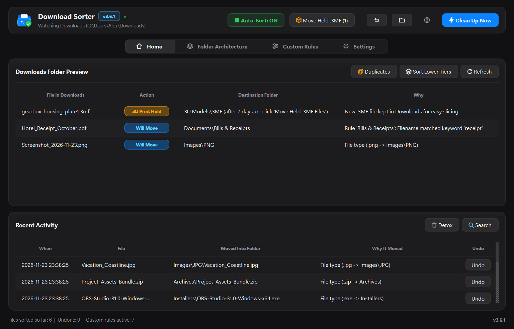
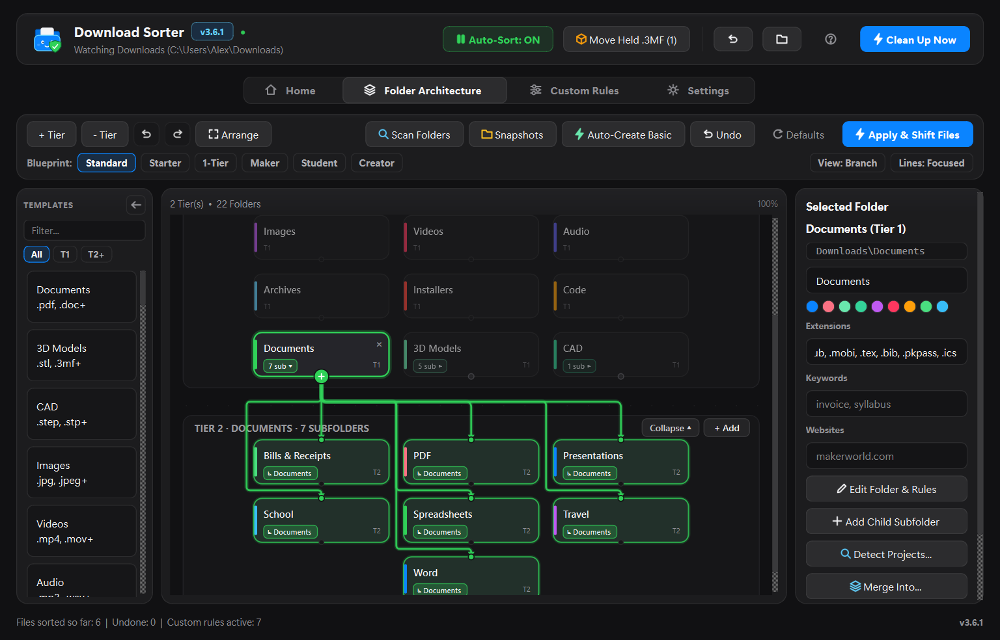
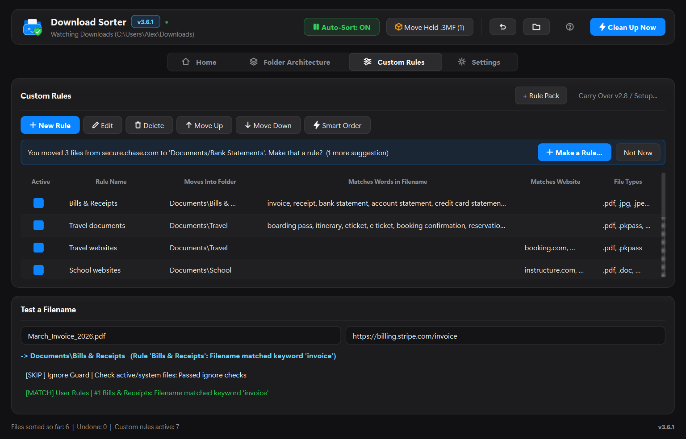

# Download Sorter

> **Made by Devyn Fidel (2026)** · [MIT License](LICENSE)

[](https://github.com/The-Osprey1/Download-Sorter/releases)
[](https://github.com/The-Osprey1/Download-Sorter/actions)
[](https://github.com/The-Osprey1/Download-Sorter/actions/workflows/codeql.yml)
[](https://microsoft.com/windows)
[](LICENSE)

**Download Sorter keeps your Downloads folder tidy.** A few seconds after a download finishes, it moves the file into a folder for its type (Documents, Images, Installers and so on), right inside Downloads. Everything happens on your PC, and every move can be undone.

It watches the folder Windows uses for Downloads, even if you moved it to another drive or OneDrive moved it.

Version 3 is one program with one window. [Coming from 2.x? Read this first.](#coming-from-2x)



<details>
<summary><strong>More screenshots: Folder Architecture &amp; Custom Rules</strong></summary>

<br>

**Folder Architecture** — branch-focused visual folder map with subfolder presets, **Scan Folders**, **Detect Projects**, and **Merge Into**:



**Custom Rules** — priority-ordered rules, one-click **+ Rule Pack** presets, learned move suggestions, and a live filename tester:



</details>

---

## Get it

1. **Download** the installer, `DownloadSorter-Setup-v<version>-windows-x64.exe`, from the [releases page](https://github.com/The-Osprey1/Download-Sorter/releases/latest).
2. **Run it.** Windows will probably show a blue "Windows protected your PC" screen the first time. [Here's why, and what to click](#windows-protected-your-pc).
   - It installs just for you, in `%LOCALAPPDATA%\Programs\DownloadSorter`. No administrator password is needed.
   - It adds Start menu and desktop shortcuts, and an entry in Installed apps.
3. **Follow the three welcome steps** the first time the window opens. The second step asks what you download most (school work, bills and receipts, travel, contracts, job hunting, 3D printing) and adds rules for the ones you tick. Nothing is sorted until you finish or skip the steps.

You need Windows 10 or 11. Nothing else needs to be installed.

## What it does

- **New downloads are filed a few seconds after they finish.** Half-finished downloads (`.crdownload`, `.part`, `.tmp`, `.download`), and files another program still has open, are left alone and tried again later.
- **Only loose files at the top of Downloads are sorted.** Anything already inside a folder is never touched during automatic sorting.
- **Other folders too, if you like.** Add your Desktop, Screenshots or any folder under Settings → **Also Tidy These Folders**. Each is sorted into folders inside itself; files nothing matches stay put.
- **Home shows what would happen before it happens.** The preview lists every file in Downloads with where it will go and why. Below it, **Recent Activity** has an **Undo** button on every row, plus **Search** (`Ctrl+Shift+Space`) and **Detox** (recycles installers older than 30 days).
- **Files land in folders inside Downloads.** By default a main folder, then a folder for each kind of file:

  ```text
  Downloads/
    ├── Documents/
    │     ├── PDF/
    │     └── ...
    ├── Images/
    ├── 3D Models/
    │     ├── 3MF/
    │     └── ...
    ├── ...
    ├── Other/         (anything nothing else matched)
    └── _Duplicates/   (exact copies of a file that is already sorted)
  ```

  To keep everything one level deep, turn off the type subfolders in **Settings**. Unrecognized file types can go to `Other` or stay where they are.
- **Folder Architecture lets you design the layout visually** (turn on **Show Advanced Tools** in Settings to see it). Click any folder to expand its branch (`View: Branch` / `View: All`), add subfolders with pre-filled file types or classifications, **Scan Folders** from your existing Downloads tree, save **Snapshots**, run **Detect Projects...** to group multi-file projects into subfolders, combine folders with **Merge Into...** (`Shift+Drag`), safely evacuate files when removing a folder, and **Apply & Shift Files** with full **Undo**.
- **Custom Rules send files by name, website, or content.** A rule matches words in the file name, the website the file came from, file types, exclude words, regex patterns, size/age bounds, or words inside PDFs—and can optionally rename files with tokens (`{year}`, `{month}`, `{exif_year}`, `{host}`) or auto-unzip safe `.zip` archives. Words work in any language, and accents are optional (`resume` matches `Résumé.pdf`). Rules are checked top to bottom; the first match wins.
- **Rule packs & offline smart hints.** Add ready-made rules in one click (**School**, **Job hunting**, **Bills & receipts**, **Travel**, **Contracts**, **3D printing**). Move similar files by hand a few times and Download Sorter offers to turn that pattern into a rule. In Settings, **Experimental AI** adds 100% offline Naive Bayes & TF-IDF route hints, optional confidence-gated auto-routing for unmatched files, and **AI Insights...**.
- **Smart duplicate handling.** Exact copies (verified by sparse + full SHA-256 hashing) are quarantined to `_Duplicates` instead of overwriting originals, with one-click **Replace Old**, **Delete & Locate Old** (via the Recycle Bin), or **Keep Both** on the notification ribbon and in **Duplicates**.
- **A new `.3mf` stays in Downloads for 7 days**, so your slicer can still find it. When the days are up it also stays for as long as Bambu Studio, OrcaSlicer, PrusaSlicer or Cura is running (14 days at most), and updates Bambu/Orca `recent_projects` paths when moved. **Move Held .3MF** files them straight away.
- **Optional Chrome Extension (v1.2).** Load the unpacked companion extension (`Settings` → **Chrome Extension** → `?` **Setup Guide**) for **Sort Downloads Now**, right-click **Save & Sort to**, **Pin site...** rule creation, duplicate badges, and one-click **Reveal**.
- **A ribbon in the top-right corner tells you what moved**, with **Undo**. Choose how long it stays in Settings; hover to pause it. It stays away while a game, a full-screen video, a presentation or the lock screen is up; the files are still sorted and listed on Home.
- **Bigger text & screen readers.** Download Sorter follows Windows' text size (Settings → Accessibility → Text size, up to 150%) and labels every button, switch, and input for Narrator, NVDA, and JAWS.
- **Recent File Insert.** When another program asks you to choose a file to open or upload, a small pill on the right monitor offers the file Download Sorter just filed, so you don't have to go looking for it.

## How a file's folder is chosen

Every file goes through the same four steps. The first step that gives an answer wins.

1. **Should it be left alone?** Temporary and half-downloaded files (`.crdownload`, `.part`, `.tmp`, `.download`, ...) and ignored names are skipped.
2. **Where did it come from?** Windows records the website a file was downloaded from; rules that name a website are checked against it.
3. **Your rules**, in the order shown on the Custom Rules page (plus image screenshot metadata assist when applicable).
4. **Its file type**, using the built-in list of extensions (and magic-byte container checks when needed); otherwise optional offline **AI Auto-Route** if enabled, `Other`, or left in place.

Then, before anything moves:

- **Same name or exact copy already there?** If the two files are identical, the new one goes to `_Duplicates`. If they differ, the new one becomes `name (2).ext`. Nothing is overwritten and nothing is deleted.
- **The move is written to the history first** and marked done afterwards, so a crash or power cut can't lose track of a file.

Check any file name from a command line:

```powershell
DownloadSorter-cli.exe --explain "benchy_plate1.3mf" --url "https://makerworld.com/en/models/123"
```

## Windows protected your PC

New apps from small developers aren't signed with a paid code-signing certificate yet, so Windows SmartScreen warns about them. To install anyway:

1. Click **More info**.
2. Click **Run anyway**.

To check that your download is exactly what was published:

1. Download `checksums.txt` from the same release page.
2. Run this in PowerShell, in the folder where the installer is:

   ```powershell
   Get-FileHash .\DownloadSorter-Setup-v<version>-windows-x64.exe -Algorithm SHA256
   ```

3. The long code it prints should match the line for the installer in `checksums.txt`.

All the source code is in this repository, and the installer is built from it by GitHub, in the open (see the [release workflow](.github/workflows/release.yml)).

## Smart App Control

Windows 11 includes **Smart App Control**, which is stricter than SmartScreen and has no **Run anyway** button. It checks every program and library file as it loads and blocks any unsigned file that Microsoft does not yet widely recognize.

Until Download Sorter is code-signed, the only way to run it on a Windows 11 PC with Smart App Control enabled is to turn Smart App Control **Off** (Windows Security → **App & browser control** → **Smart App Control settings**). There is no per-app bypass.

Since the April 2026 cumulative update (KB5083769), Smart App Control can be switched on and off in **Windows Security → App & browser control** on current builds. Microsoft has confirmed that the October 2026 update (KB5127648) greys out that switch for some people, with no fix date yet, so turning it off may be hard to undo for now.

Releases that aren't signed say so at the top of their release notes. Progress on signing is in the [Code signing policy](#code-signing-policy) below.

## Code signing policy

**Releases are not code-signed yet.** Download Sorter is a free, open-source hobby project and is setting up free code signing for open-source projects from [SignPath Foundation](https://signpath.org).

<!-- Once SignPath Foundation approves the project, replace the paragraph above with:
Free code signing provided by [SignPath.io](https://about.signpath.io), certificate by [SignPath Foundation](https://signpath.org).
-->

- **What gets signed:** `DownloadSorter.exe`, `DownloadSorter-cli.exe`, the three uninstall scripts (`uninstall.ps1`, `uninstall_context_menu.ps1`, `uninstall_startup.ps1`) and the setup file. Files from other publishers that come with the app (Python, Qt, Microsoft) keep their publishers' own signatures and are never signed by this project.
- **How releases are built:** every release is built by GitHub from the source code in this repository, using the public [release workflow](.github/workflows/release.yml). Nothing built on a personal computer is signed.
- **Team roles:**
  - Committers and reviewers: [Devyn Fidel](https://github.com/The-Osprey1)
  - Approvers: [Devyn Fidel](https://github.com/The-Osprey1)
- **Privacy:** Download Sorter does not send any information to other networked systems except as described in [Privacy](#privacy): once a day it asks GitHub which version is newest (this can be switched off), and it downloads an update only when you click **Download and install**.

## Privacy

- **Your files never leave your PC.** Rules, settings, history, offline route learning (`learned_routes.json`), and the log all stay in `%LOCALAPPDATA%\download-sorter-v3`. All smart hints and Experimental AI features are statistical models computed locally on your machine—never sent to any cloud or external AI service.
- **One small network request, once a day:** Download Sorter asks GitHub which version is newest, so it can tell you when there's an update. Only the app's name and version are sent. An update is only downloaded when you click **Download and install**, and only from this project's GitHub release page. Turn it off in **Settings**, under "Check for new versions once a day".
- No accounts, no ads, no tracking.

## Undo, updates, uninstalling and help

- **Undo:** click **Undo** on Home or on a ribbon, or right-click the tray icon (near the clock) and choose **Undo Last Batch**. One file: the **Undo** button on its row.
  - If a newer file has taken the original name, the file being put back is saved beside it as `name (Restored).ext`.
  - A file that is open in another program is skipped and reported; close it and undo again.
- **Pause:** the Auto-Sort button on Home, or **Pause / Resume** on the tray icon.
- **Updates:** when a new version is out, the window shows "Download Sorter X is available". **Download and install** downloads it, checks it against the release's published checksum, then closes Download Sorter for a few seconds and opens it again. Rules and settings are kept.
- **Start with Windows** and the **right-click menu** ("Sort with Download Sorter" on a folder) are switches in Settings.
- **Back up or move your setup:** Settings → Upgrade & Backup exports your rules and folder layout to one file; **Carry Over v2.8 / Setup...** loads it back.
- **Uninstall:** Windows Settings → Apps → Installed apps → Download Sorter → Uninstall. It asks whether to also delete your rules and history.
- **Something went wrong?** Open an [issue](https://github.com/The-Osprey1/Download-Sorter/issues/new/choose). If you can, attach `%LOCALAPPDATA%\download-sorter-v3\sorter_v3.log` (look it over first: it contains file names). Unexpected errors are written there with the details a fix needs.

*Unattended install, for IT folks:* `DownloadSorter-Setup-v<version>-windows-x64.exe /S` (optional `/D=C:\Custom\Path`). The Inno Setup spellings `/VERYSILENT`, `/SILENT` and `/DIR=` work too.

## Coming from 2.x

Version 3 is a ground-up single-process PySide6 rewrite.

- **Your rules come with you.** The first time version 3 starts it copies your 2.x word rules, watched folder and `.3mf` hold setting into its own settings folder (`download-sorter-v3`). Your 2.x settings are left where they were, and **Carry Over v2.8 / Setup...** does the import again whenever you want. Other 2.x settings start from the version 3 defaults.
- **Files 2.x already sorted stay where they are.** Version 3 only sorts loose files at the top of Downloads unless you explicitly run **Apply & Shift Files** or **Sort Lower Tiers**.
- **Back in 3.2–3.6:** the `Ctrl+Shift+Space` search window, rule suggestions from files you move by hand, offline **Experimental AI** route hints, **Detect Projects...** in Folder Architecture, **Also Tidy These Folders** (for Desktop, Screenshots, etc.), safe `.zip` auto-extraction, rules that read inside PDFs, old-installer cleanup (**Detox**), photo folders by year and month, and the Chrome Extension v1.2 bridge.
- **Different from 2.x:** the standalone 2.x Projects page (use Folder Architecture → **Detect Projects...** instead), Clean up a folder (remodel), and the old G-code/MakerWorld scraping checks are not part of 3.x. If you rely on one of these, stay on 2.8 for now and [open an issue](https://github.com/The-Osprey1/Download-Sorter/issues).

---

# For power users and developers

## Command line

`DownloadSorter-cli.exe` (in the install folder) prints to the console; `DownloadSorter.exe` takes the same options without one. When the app is already running, `--sort-now`, `--file-held` and `--undo` are carried out by it and answered when the files have been moved.

| Option | What it does |
|---|---|
| `--version` | Print the version. |
| `--status` | Running or stopped, paused or active, watched folder, number of rules and moves. |
| `--explain FILENAME [--url URL]` | Show where a file name would go and every step of the decision. |
| `--simulate` | List every file in the watched folder and what would happen to it. Moves nothing. |
| `--sort-now` | Sort the watched folder once. |
| `--file-held` | File the `.3mf` files that are being held. |
| `--undo` | Undo the latest batch. |
| `--home` | Open the window (and the tray icon). |
| `--tray` | Start in the tray without opening the window. |
| `--dialog HWND` | Show Recent File Insert against an open file dialog. |
| `--quit` | Close the running app. |
| `--data-dir`, `--watch-dir` | Use a different settings folder or watched folder. |
| `FOLDER` | Sort that folder once (what the right-click menu runs). |

## Where things are kept

Everything is in `%LOCALAPPDATA%\download-sorter-v3`:

| File | Contents |
|---|---|
| `config.json` | Settings, rules and folder layout (`config.json.bak` is the previous save). |
| `state.db` | The history of moves and sparse-hash deduplication index, used by Undo (SQLite). |
| `learned_routes.json` | Local move tallies and statistical Naive Bayes / TF-IDF route hints (resettable in Settings). |
| `sorter_v3.log` | The log. It starts a new file at 2 MB and keeps two older ones (`.1`, `.2`). |
| `recent_files.json` | The files Recent File Insert can offer. |
| `updates\` | A downloaded installer, until it has been installed. |

## Code layout

```text
main.py                     entry point for both executables
about.py                    name and version (the single source of truth)
src/download_sorter/
  router.py                 the four routing steps, magic-byte/ZIP/PDF/EXIF checks; no mutations
  config.py                 settings, rules, starter templates, 2.x carry-over
  dest.py                   destination path sanitization, dynamic tokens, and rename templates
  architecture.py           visual Folder Architecture tree, presets, folder scanner, and snapshots
  project_detect.py         multi-file project clustering for Detect Projects
  learning.py               manual-move rule suggestions and offline Naive Bayes / TF-IDF learner
  service.py                the folder watcher and the sorting loop
  fs_ops.py                 safe moves, sparse-hash duplicates, zip-bomb-safe unzip, Detox, undo
  db.py                     move history with a two-phase SQLite journal
  chrome_bridge.py          Chrome Native Messaging host and extension manifest registration
  ipc.py                    single-instance commands between copies
  update_check.py, updater.py   the daily version check and SHA-256-verified download
  quiet_time.py             holds ribbons during full-screen apps and presentations
  diagnostics.py            the size-capped log and unexpected-error capture
  quick_switcher.py         Recent File Insert
  windows_integration.py    Start with Windows and Explorer folder context menu
  cli.py                    the command line
  ui/                       window, canvas, tray, ribbons, background workers, accessibility
chrome_extension/           unpacked Manifest V3 companion Chrome extension (v1.2.0)
tests_v3/                   the test suite
build_release.py            builds dist/ (PyInstaller, zip, setup file, checksums)
installer_builder.py        the single-file Windows setup program
verify_release.py           release preflight
```

## Developing

```powershell
python -m venv .venv
.venv\Scripts\python.exe -m pip install -r requirements.txt pytest pytest-timeout pyinstaller ruff

.venv\Scripts\python.exe main.py --simulate          # run from source
.venv\Scripts\python.exe -m ruff check .             # lint check (runs on GitHub CI)
.venv\Scripts\python.exe -m pytest tests_v3 -v       # tests
.venv\Scripts\python.exe build_release.py            # build dist\
.venv\Scripts\python.exe verify_release.py           # release preflight (versions, CLI, tests, built files)
```

A release is made by pushing a `v*` tag: the [release workflow](.github/workflows/release.yml) runs the tests, builds, runs the preflight, checks that an update replaces a running copy, and publishes the setup file, the zip and `checksums.txt`.

## Contributing & Security

- **Contributing:** see [CONTRIBUTING.md](CONTRIBUTING.md) and [CODE_OF_CONDUCT.md](CODE_OF_CONDUCT.md).
- **Beta testing guide:** see [BETA_TESTING.md](BETA_TESTING.md).
- **Security & privacy:** see [SECURITY.md](SECURITY.md): no telemetry, local-first, and how to report a problem.
- **Changelog:** see [CHANGELOG.md](CHANGELOG.md).

## Credits

**Download Sorter** was created by **Devyn Fidel** (2026).
Repository: https://github.com/The-Osprey1/Download-Sorter

## License

This project is licensed under the [MIT License](LICENSE) - Copyright (c) 2026 Devyn Fidel.
