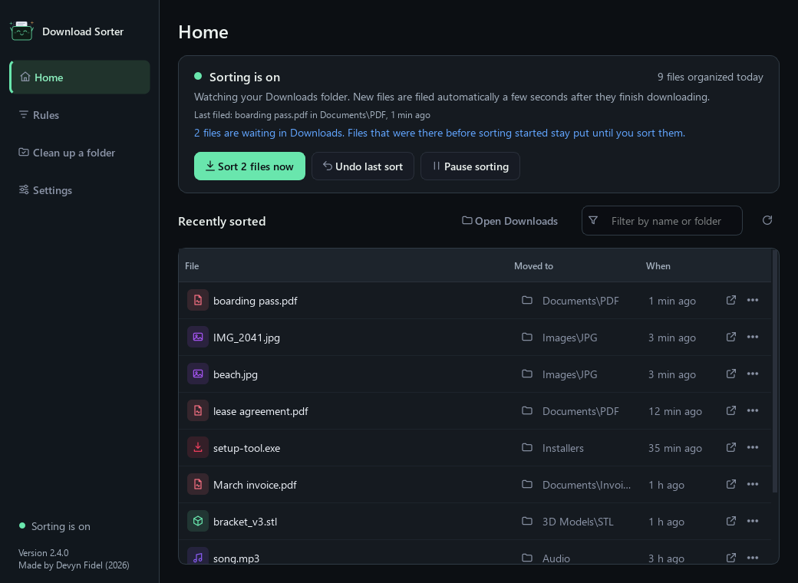
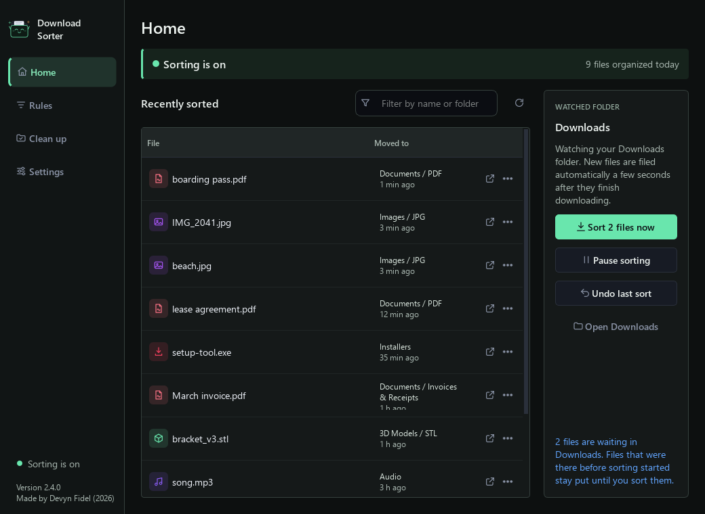

# Visual proposal: Refined Mint and Dark Workspace

**Status: design review, no direction selected.** Two native PySide6 preview concepts for Download Sorter. This branch adds documentation and preview assets only; it does not change the shipped application.

## Start here

- [Open the local comparison gallery](comparison.html) after checking out/downloading this branch. GitHub displays HTML source rather than executing it.
- [Integration brief for Claude Code](INTEGRATION.md).
- [Validation results and limitations](validation.md).
- [Reproducible preview source](preview-source.zip): isolated adapters plus the historical source snapshot used to render them. Extract into a separate directory; do not overlay the old snapshot onto the current checkout.

### A — Refined Mint

Retains the sidebar, status card, and page structure. Refines type hierarchy (24/16/14/12 px), spacing, mint selected states, table readability, and long option labels. The lower-risk direction for an incremental refresh.

### B — Dark Workspace

Uses a narrower navigation rail, slim sorting-status strip, and a folder/action panel beside a larger activity area. At the minimum window size the panel moves above the list. Filename testing moves above the Rules table; Settings gains a section index; Cleanup gains sequence labels; onboarding gains a progress bar.

## Important source/version distinction

The previews were rendered from commit `513445f4c54b9c89ead87f045fc1add8158a48fd` (the 2.4.0 UI). This proposal branch is based on current main at `5dafdb2191caad5d4a5d75ba366b0dc8fabe905b`, which includes the Qt migration in #45. The Projects hub and Qt tray work in #46 must also be considered if/when integrated. Missing newer screens in these historical previews are not a proposal to remove them.

## Included evidence

- 26 matched states per direction at standard and minimum size: **104 PNGs** checked into this review branch.
- Original generation: **312 PNGs** covering the same states at 100%, 150%, and 200%. All 12 render manifests and process results are preserved. Higher-resolution duplicates are omitted from Git to keep the proposal smaller; regenerate them from the source archive.
- Main window: 1040 × 760 and 900 × 640. Onboarding: 760 × 680 and 720 × 640.
- 51 existing UI foundation/workflow/layout tests passed against the historical source snapshot. This is not a test result for current main or a production implementation of these concepts.
- Gallery JavaScript syntax and asset paths were checked. Browser interaction was not verified because localhost returned 403 and the automation policy blocked file navigation.
- No full application test-suite claim; no production API, settings-schema, sorting, persistence, or generated-theme changes.

## Screen index

Each link opens a full-resolution PNG. Use the local HTML gallery to switch between directions and standard/minimum sizes.

| Screen/state | A — Refined Mint | B — Dark Workspace |
|---|---|---|
| home running | [View](A/standard/home_running.png) | [View](B/standard/home_running.png) |
| home long paths | [View](A/standard/home_long_paths.png) | [View](B/standard/home_long_paths.png) |
| home row menu | [View](A/standard/home_row_menu.png) | [View](B/standard/home_row_menu.png) |
| home paused | [View](A/standard/home_paused.png) | [View](B/standard/home_paused.png) |
| home off | [View](A/standard/home_off.png) | [View](B/standard/home_off.png) |
| home empty | [View](A/standard/home_empty.png) | [View](B/standard/home_empty.png) |
| rules name rules | [View](A/standard/rules_name_rules.png) | [View](B/standard/rules_name_rules.png) |
| rules sandbox match | [View](A/standard/rules_sandbox_match.png) | [View](B/standard/rules_sandbox_match.png) |
| rules sandbox nomatch | [View](A/standard/rules_sandbox_nomatch.png) | [View](B/standard/rules_sandbox_nomatch.png) |
| rules file types | [View](A/standard/rules_file_types.png) | [View](B/standard/rules_file_types.png) |
| shell notice and dots | [View](A/standard/shell_notice_and_dots.png) | [View](B/standard/shell_notice_and_dots.png) |
| cleanup empty | [View](A/standard/cleanup_empty.png) | [View](B/standard/cleanup_empty.png) |
| cleanup scanned | [View](A/standard/cleanup_scanned.png) | [View](B/standard/cleanup_scanned.png) |
| settings | [View](A/standard/settings.png) | [View](B/standard/settings.png) |
| settings full | [View](A/standard/settings_full.png) | [View](B/standard/settings_full.png) |
| wizard with folders step1 | [View](A/standard/wizard_with_folders_step1.png) | [View](B/standard/wizard_with_folders_step1.png) |
| wizard with folders step2 | [View](A/standard/wizard_with_folders_step2.png) | [View](B/standard/wizard_with_folders_step2.png) |
| wizard with folders step3 | [View](A/standard/wizard_with_folders_step3.png) | [View](B/standard/wizard_with_folders_step3.png) |
| wizard no folders step1 | [View](A/standard/wizard_no_folders_step1.png) | [View](B/standard/wizard_no_folders_step1.png) |
| wizard no folders step2 | [View](A/standard/wizard_no_folders_step2.png) | [View](B/standard/wizard_no_folders_step2.png) |
| wizard no folders step3 | [View](A/standard/wizard_no_folders_step3.png) | [View](B/standard/wizard_no_folders_step3.png) |
| dialog rule editor | [View](A/standard/dialog_rule_editor.png) | [View](B/standard/dialog_rule_editor.png) |
| dialog rule library | [View](A/standard/dialog_rule_library.png) | [View](B/standard/dialog_rule_library.png) |
| dialog unsaved changes | [View](A/standard/dialog_unsaved_changes.png) | [View](B/standard/dialog_unsaved_changes.png) |
| banners | [View](A/standard/banners.png) | [View](B/standard/banners.png) |
| roles | [View](A/standard/roles.png) | [View](B/standard/roles.png) |
